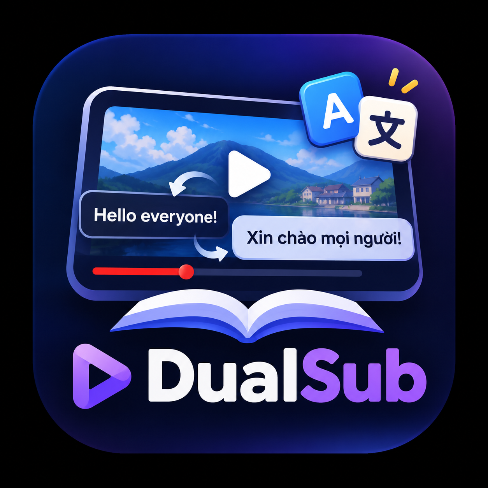

<p align="center">
  
</p>

<h1 align="center">DualSub</h1>

<p align="center">
  <strong>Ứng dụng desktop cá nhân học ngoại ngữ qua video YouTube với phụ đề song ngữ đồng bộ và AI.</strong>
</p>

<p align="center">
  DualSub giúp bạn biến mọi video YouTube thành tài liệu luyện nghe, học từ vựng và ngữ pháp trực quan: dán link video, xem phụ đề gốc chạy song song cùng bản dịch tiếng Việt theo thời gian thực, tra từ chỉ với một cú click và xuất thẻ học thông minh sang Anki.
</p>

---

## ✨ Tính năng nổi bật

### 1. 📺 Trình phát video & Phụ đề song ngữ
- **Nhúng YouTube IFrame Player API** sạch sẽ, ẩn toàn bộ controls mặc định của YouTube và thay thế bằng bộ điều khiển chuyên dụng cho người học.
- **5 chế độ hiển thị linh hoạt**:
  - `Song ngữ`: Hiện cả phụ đề gốc và bản dịch tiếng Việt.
  - `Chỉ gốc`: Luyện nghe chuyên sâu, không bị phân tâm bởi bản dịch.
  - `Chỉ dịch`: Kiểm tra mức độ hiểu nội dung.
  - `Che bản dịch (Veil)`: Làm mờ bản dịch; di chuột vào khi cần xem nghĩa.
  - `Tắt`: Ẩn hoàn toàn phụ đề.
- **Lặp lại câu (Loop mode)**: Luyện nghe và shadowing từng câu nói với phím tắt `R`.
- **Tốc độ phát linh hoạt**: Điều chỉnh nhanh `0.5×`, `0.75×`, `1×`, `1.25×`.

### 2. 🎯 Tách link & Trích xuất phụ đề thông minh
- Hỗ trợ mọi định dạng link YouTube: `youtube.com/watch?v=...`, `youtu.be/...`, `shorts/...`, có kèm mốc thời gian `?t=...`.
- Tích hợp **YouTube.js (`youtubei.js`)** lấy danh sách caption tracks thực tế.
- Thuật toán ưu tiên: `Phụ đề người đăng (Manual) > Phụ đề tự động (ASR)`.
- Tự động gộp câu ASR vụn vặt thành câu hoàn chỉnh dựa trên dấu câu, độ ngắt quãng im lặng và loại bỏ từ trùng lặp do cửa sổ cuộn.

### 3. 🌐 Dịch thuật đa tầng & Bộ nhớ đệm (Cache)
- **Kiến trúc Translation Provider** dễ dàng chuyển đổi:
  - **Google Translate miễn phí**: Hoạt động ngay, không cần cấu hình API key.
  - **DeepL API**: Hỗ trợ cả gói Free (`:fx`) và Pro cho bản dịch tự nhiên.
  - **Claude API (Anthropic)**: Tận dụng sức mạnh của các model Claude (mặc định `claude-haiku-4-5`).
- **Dịch theo lô (Batching)**: Dịch ngay 8 câu đầu tiên để người dùng học tức thì, các câu còn lại tự động dịch nền và truyền về giao diện qua IPC events.
- **Cache vĩnh viễn**: Lưu transcript và bản dịch theo `videoId` vào ổ đĩa (`userData/cache/`). Mở lại video cũ sẽ nạp tức thì mà không cần tải mạng hay dịch lại.
- **Bảo mật**: API key được lưu ở main process và mã hoá an toàn bằng hệ điều hành thông qua Electron `safeStorage` (Windows DPAPI / macOS Keychain).

### 4. 📖 Tra từ điển 1-Click & Lưu từ vựng
- Bấm vào bất kỳ từ nào trong ô **"Câu đang nói"** để mở popover tra nghĩa:
  - Với **Tiếng Anh**: Tự động tra **Free Dictionary API** lấy phiên âm quốc tế (IPA), loại từ (danh từ, động từ...) và định nghĩa tiếng Việt.
  - Tự động fallback dịch nghĩa trực tiếp nếu là từ chia thì, từ ghép hoặc các ngôn ngữ khác (Nhật, Hàn, Trung, Pháp...).
- **Lưu từ vựng kèm ngữ cảnh**:
  - Tự động đính kèm câu thoại ví dụ, `videoId` và mốc thời gian chính xác.
  - Các từ đã lưu sẽ được gạch chân highlight nổi bật khi xuất hiện lại trong video.
- **Ôn tập tức thì**: Bấm vào bất kỳ từ nào trong tab **"Từ đã lưu"**, video sẽ tự động mở và tua đến đúng phân đoạn người bản xứ đang nói từ đó.

### 5. 🗃️ Xuất thẻ Anki (.csv)
- Nút **"Xuất Anki"** tạo file `.csv` định dạng chuẩn quốc tế:
  - Cột 1 (*Front*): Từ vựng + `[Phiên âm]` + `(Loại từ)`
  - Cột 2 (*Back*): Nghĩa tiếng Việt
  - Cột 3 (*Example*): Câu ví dụ trong video
  - Cột 4 (*Source*): Link YouTube kèm mốc thời gian phát chính xác (ví dụ `https://youtu.be/...?t=42`)
- Tích hợp sẵn **UTF-8 BOM**, mở trực tiếp trên Excel hoặc nhập vào Anki mà không bị lỗi font tiếng Việt.

### 6. 🎙️ Whisper AI (Nhận dạng ngoại tuyến)
- Dành riêng cho video **không có sẵn phụ đề** trên YouTube:
  - Tải luồng audio bằng `yt-dlp`.
  - Tự động chuẩn hoá âm thanh về chuẩn 16kHz WAV mono bằng `ffmpeg`.
  - Nhận dạng giọng nói tự động và trích xuất timestamp từng câu thông qua `whisper.cpp`.

---

## ⌨️ Phím tắt nhanh

| Phím tắt | Chức năng |
|---|---|
| <kbd>Space</kbd> | Phát / Tạm dừng video |
| <kbd>←</kbd> | Quay về câu trước (nếu đang nghe quá 1.5s sẽ về đầu câu hiện tại) |
| <kbd>→</kbd> | Chuyển sang câu tiếp theo |
| <kbd>R</kbd> | Bật / Tắt lặp lại câu hiện tại |
| <kbd>Esc</kbd> | Đóng popup tra từ / đóng hộp thoại Cài đặt |

---

## 🛠️ Công nghệ sử dụng

- **Khung ứng dụng**: [Electron](https://www.electronjs.org/) + [TypeScript](https://www.typescriptlang.org/) + [Vite](https://vitejs.dev/) thông qua [`electron-vite`](https://electron-vite.org/).
- **Phía Main**: Giao tiếp IPC an toàn (`contextIsolation: true`, `nodeIntegration: false`, preload scripts), YouTube.js (`youtubei.js`), safeStorage.
- **Phía Renderer**: Pure TypeScript + Modern CSS (CSS Variables, Responsive Design, Dark theme mặc định).
- **Trình phát**: YouTube IFrame Player API kết hợp Local Server `127.0.0.1` nội bộ để giải quyết triệt để lỗi hạn chế Embed (`Referer` / `Origin`).
- **Kiểm thử**: [Vitest](https://vitest.dev/) (Unit tests & Integration tests).

---

## 🚀 Hướng dẫn cài đặt & Khởi chạy

### Yêu cầu môi trường
- **Node.js**: Phiên bản 20.19+ hoặc 22.12+ LTS
- **Package Manager**: [pnpm](https://pnpm.io/) (khuyên dùng) hoặc `npm`

### Cài đặt dependencies
```powershell
# Cài đặt toàn bộ packages
pnpm install

# Tải binary Electron nếu lần đầu cài đặt
node node_modules/electron/install.js
```

### Chế độ phát triển (Development)
```powershell
# Khởi chạy ứng dụng với hot-reload
pnpm run dev
```

> **Mẹo nhỏ trên Windows / IDE terminal:**
> Nếu gặp thông báo `Cannot read properties of undefined (reading 'whenReady')`, hãy xoá biến môi trường terminal bằng lệnh:
> ```powershell
> Remove-Item Env:ELECTRON_RUN_AS_NODE -ErrorAction SilentlyContinue
> pnpm run dev
> ```

### Kiểm tra mã nguồn & Unit tests
```powershell
# Kiểm tra TypeScript typecheck
pnpm run typecheck

# Chạy toàn bộ Unit Tests
pnpm run test

# Chạy Integration Test thực tế với YouTube API (cần mạng)
pnpm run test:live
```

### Đóng gói ứng dụng (Build Executable)
```powershell
# Build bộ cài đặt cho Windows (.exe installer NSIS)
pnpm run dist:win

# Build bộ cài đặt cho macOS (.dmg)
pnpm run dist:mac
```
File cài đặt hoàn chỉnh sẽ nằm trong thư mục `dist/`.

---

## ⚙️ Cấu hình Whisper AI (Cho video không phụ đề)

Khi gặp video không có phụ đề trên YouTube, ứng dụng sẽ hiển thị nút **"Tạo phụ đề bằng Whisper (AI)"**. Để sử dụng tính năng này ngoại tuyến:

1. **`ffmpeg`**: Đã cài đặt trên hệ thống hoặc đặt file `ffmpeg.exe` vào `resources/bin/`.
2. **`yt-dlp`**: Tải file [`yt-dlp.exe`](https://github.com/yt-dlp/yt-dlp/releases) và đặt vào `resources/bin/` (hoặc cài vào PATH).
3. **`whisper.cpp`**: Tải bản build Windows x64 từ [whisper.cpp releases](https://github.com/ggerganov/whisper.cpp/releases), đặt `whisper-cli.exe` (hoặc `main.exe`) vào `resources/bin/`.
4. **Whisper Model**: Tải model định dạng ggml (ví dụ [`ggml-tiny.bin`](https://huggingface.co/ggerganov/whisper.cpp/resolve/main/ggml-tiny.bin) ~75MB hoặc [`ggml-base.bin`](https://huggingface.co/ggerganov/whisper.cpp/resolve/main/ggml-base.bin) ~140MB) và đặt vào `resources/models/`.

> Bạn có thể bấm nút **"Cài đặt"** trên thanh tiêu đề của app để kiểm tra trạng thái xanh của các công cụ này bất cứ lúc nào.

---

## 📂 Cấu trúc thư mục

```
dual-sub/
├── resources/                 # Chứa binary (bin/) và model AI (models/)
├── src/
│   ├── shared/                # Khai báo kiểu chung (types.ts), xử lý URL (videoId.ts)
│   ├── main/                  # Tiến trình Electron Main Process
│   │   ├── index.ts           # Khởi tạo cửa sổ, cấu hình Referer & Protocol
│   │   ├── ipc.ts             # Đăng ký các kênh giao tiếp IPC
│   │   ├── staticServer.ts    # HTTP server nội bộ (127.0.0.1) phục vụ embed player
│   │   ├── youtube/           # YouTube.js Innertube client & xử lý lỗi tiếng Việt
│   │   ├── captions/          # Lấy track phụ đề, chuẩn hoá & gộp câu ASR
│   │   ├── translate/         # Translation providers (Google, DeepL, Claude, batcher)
│   │   ├── dictionary/        # Tra từ điển Free Dictionary API & fallback
│   │   ├── storage/           # Quản lý Cache video, từ vựng cá nhân, xuất CSV Anki
│   │   └── asr/               # Tích hợp yt-dlp, ffmpeg và whisper.cpp
│   ├── preload/               # Script Preload mở API an toàn qua contextBridge
│   └── renderer/              # Giao diện người dùng (HTML5, Modern CSS, TS modules)
│       ├── index.html         # Khung giao diện chính
│       ├── styles/            # CSS hoàn chỉnh, tối ưu Dark Mode
│       └── src/               # UI controllers (player, transcript, vocab, dialogs)
├── tests/                     # Bộ unit test & live test (Vitest)
└── package.json
```

---

## 📄 Bản quyền & Sử dụng

Dự án cá nhân phục vụ mục đích học tập phi thương mại.
Mọi thắc mắc hoặc đóng góp ý tưởng xin vui lòng gửi issue tại repository!
